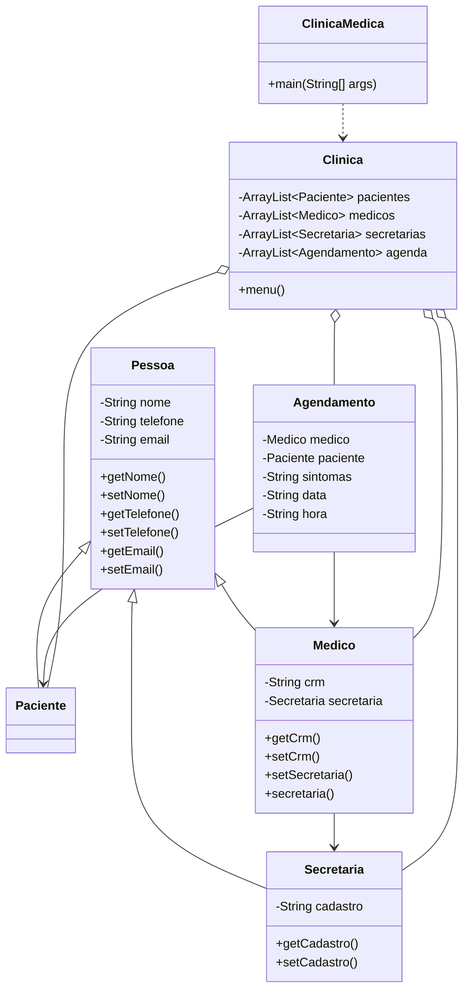

# 🏥 Clínica Médica — Sistema em Java
 
Sistema em Java que simula o funcionamento de uma clínica médica, desenvolvido com **Programação Orientada a Objetos (POO)**. A aplicação roda no terminal (console) e permite cadastrar pacientes, médicos e secretárias, além de agendar e consultar consultas.
 
---
 
## 📚 Informações Acadêmicas
 
| Campo | Informação |
|---|---|
| **Matéria** | Algoritmos e Programação |
| **Professor** | Nicolas Kassalias |
 
### 👥 Integrantes
 
| Nome | RA |
|---|---|
| Gabriel Dornelas Assis da Silva | 826222766 |
| Samuel Norberto dos Santos | 826225495 |
 
---
 
## 📋 Sumário
 
1. [Funcionalidades](#-funcionalidades)
2. [Conceitos aplicados](#-conceitos-aplicados)
3. [Tecnologias](#-tecnologias)
4. [Estrutura do projeto](#-estrutura-do-projeto)
5. [Diagrama de classes](#-diagrama-de-classes)
6. [Descrição das classes](#-descrição-das-classes)
7. [Menus do sistema](#-menus-do-sistema)
8. [Regras de negócio](#-regras-de-negócio)
9. [Como executar](#-como-executar)
10. [Exemplo de uso](#-exemplo-de-uso)
11. [Limitações e melhorias futuras](#-limitações-e-melhorias-futuras)
---
 
## ✅ Funcionalidades
 
- Cadastro, alteração e listagem de **pacientes**
- Cadastro, alteração e listagem de **médicos** (com CRM)
- Cadastro, alteração e listagem de **secretárias** (com matrícula)
- **Agendamento de consultas** com paciente, médico, sintomas, data e hora
- **Consulta da agenda** com todos os agendamentos realizados
- Bloqueio de **conflito de horário** para o mesmo médico
- Alteração de dados mantendo o valor atual ao pressionar `Enter`
- Leitura de números **sem travar** o programa caso o usuário digite letras
---
 
## 🧠 Conceitos aplicados
 
| Conceito | Onde aparece |
|---|---|
| **Herança** | `Paciente`, `Medico` e `Secretaria` herdam de `Pessoa` |
| **Associação entre classes** | `Agendamento` liga `Medico` e `Paciente`; `Medico` possui uma `Secretaria` |
| **Encapsulamento** | Atributos `private` com `getters` e `setters` |
| **Coleções / Arrays** | `ArrayList` armazena pacientes, médicos, secretárias e agenda |
| **Estruturas de repetição** | `do/while` nos menus e `for` nas listagens |
| **Estruturas de decisão** | `switch/case` e `if/else` |
| **Tratamento de exceções** | `try/catch` com `NumberFormatException` em `lerNumero()` |
 
---
 
## 🛠 Tecnologias
 
- **Linguagem:** Java
- **IDE:** Apache NetBeans (projeto Ant)
- **Entrada de dados:** `java.util.Scanner`
- **Armazenamento:** em memória (`ArrayList`) — os dados são perdidos ao encerrar
---
 
## 📁 Estrutura do projeto
 
```
clinica-medica-java/
├── ClinicaMedica.java     # Classe principal (main)
├── Clinica.java           # Menus e regras do sistema
├── Pessoa.java            # Classe base (nome, telefone, email)
├── Paciente.java          # Herda de Pessoa
├── Medico.java            # Herda de Pessoa (CRM + Secretaria)
├── Secretaria.java        # Herda de Pessoa (matrícula)
├── Agendamento.java       # Consulta (médico, paciente, sintomas, data, hora)
├── build.xml              # Configuração Ant (NetBeans)
├── build-impl.xml
├── genfiles.properties
├── manifest.mf
├── project.properties
├── project.xml
└── README.md
```
 
Todas as classes pertencem ao pacote `clinicamedica`.
 
---
 
## 🧩 Diagrama de classes
 

 
---
 
## 📖 Descrição das classes
 
### `ClinicaMedica`
Ponto de entrada do programa. Cria um objeto `Clinica` e chama o método `menu()`.
 
```java
package clinicamedica;
 
public class ClinicaMedica {
 
    public static void main(String[] args) {
        Clinica clinica = new Clinica();
        clinica.menu();
    }
}
```
 
### `Clinica`
Controla toda a interação com o usuário. Guarda as listas de dados e contém os menus.
 
| Atributo | Tipo | Função |
|---|---|---|
| `pacientes` | `ArrayList<Paciente>` | Pacientes cadastrados |
| `medicos` | `ArrayList<Medico>` | Médicos cadastrados |
| `secretarias` | `ArrayList<Secretaria>` | Secretárias cadastradas |
| `agenda` | `ArrayList<Agendamento>` | Consultas agendadas |
| `scanner` | `Scanner` | Leitura do teclado |
 
| Método | Função |
|---|---|
| `menu()` | Menu principal (loop até escolher `6 - Sair`) |
| `menuPacientes()` | Cadastrar, alterar e mostrar pacientes |
| `menuMedicos()` | Cadastrar, alterar e mostrar médicos |
| `menuSecretarias()` | Cadastrar, alterar e mostrar secretárias |
| `agendar()` | Cria uma consulta, validando o horário |
| `consultarAgenda()` | Lista todas as consultas |
| `mostrarPacientes()` / `mostrarMedicos()` / `mostrarSecretarias()` | Listagens numeradas |
| `lerNumero()` | Lê um inteiro; retorna `-1` se a entrada for inválida |
| `lerOuManter(campo, atual)` | Mostra o valor atual; `Enter` mantém o valor |
 
### `Pessoa`
Classe base com os dados comuns: **nome**, **telefone** e **email**, com `getters` e `setters`.
 
### `Paciente`
Herda de `Pessoa`. Construtor: `Paciente(nome, telefone, email)`.
 
### `Medico`
Herda de `Pessoa` e adiciona o **CRM** e a associação com uma **Secretaria**.
 
```java
package clinicamedica;
 
public class Medico extends Pessoa {
 
    private String crm;
    private Secretaria secretaria;
 
    public Medico(String nome, String telefone, String email, String crm) {
        super(nome, telefone, email);
        this.crm = crm;
    }
 
    public void setCrm(String crm) { this.crm = crm; }
    public String getCrm() { return this.crm; }
 
    public void setSecretaria(Secretaria secretaria) { this.secretaria = secretaria; }
    public Secretaria secretaria() { return secretaria; }
}
```
 
### `Secretaria`
Herda de `Pessoa` e adiciona a **matrícula** (atributo `cadastro`).
Construtor: `Secretaria(nome, telefone, email, cadastro)`.
 
### `Agendamento`
Representa uma consulta, ligando um `Medico` a um `Paciente`.
 
```java
package clinicamedica;
 
public class Agendamento {
 
    private Medico medico;
    private Paciente paciente;
    private String data;
    private String hora;
    private String sintomas;
 
    public Agendamento(Medico medico, Paciente paciente,
                       String sintomas, String data, String hora) {
        this.medico = medico;
        this.paciente = paciente;
        this.sintomas = sintomas;
        this.data = data;
        this.hora = hora;
    }
 
    // getters e setters de data, hora e sintomas
    // getters de paciente e medico
}
```
 
---
 
## 🖥 Menus do sistema
 
**Menu principal**
 
```
1 - Pacientes
2 - Medicos
3 - Secretarias
4 - Agendar consulta
5 - Consultar agenda
6 - Sair
```
 
**Submenu (Pacientes, Médicos e Secretárias)**
 
```
1 - Cadastrar
2 - Alterar
3 - Mostrar
0 - Voltar
```
 
---
 
## 📏 Regras de negócio
 
- Para **agendar**, é obrigatório ter ao menos **1 paciente** e **1 médico** cadastrados.
- O **mesmo médico não pode ter duas consultas** na mesma data e hora.
- Formato esperado: data `dd/mm/aaaa` e hora `hh:mm`.
- Ao **alterar** um cadastro, apertar `Enter` mantém o valor atual do campo.
- Escolhas de paciente/médico fora da lista retornam mensagem de "inválido".
- Digitar letras em campos numéricos não encerra o programa; a opção é tratada como inválida.
---
 
## ▶️ Como executar
 
### Pelo NetBeans (recomendado)
 
1. Clone o repositório:
```bash
git clone https://github.com/gddornelas/clinica-medica-java.git
```
2. Abra o NetBeans e vá em **File → Open Project**.
3. Selecione a pasta `clinica-medica-java`.
4. Execute a classe **`ClinicaMedica`** (`Shift + F6` ou botão *Run File*).
### Pelo terminal
 
Requer o **JDK** instalado. Como as classes declaram `package clinicamedica;`, compile e execute a partir de uma pasta com esse nome:
 
```bash
git clone https://github.com/gddornelas/clinica-medica-java.git
mkdir -p src/clinicamedica
cp clinica-medica-java/*.java src/clinicamedica/
cd src
javac clinicamedica/*.java
java clinicamedica.ClinicaMedica
```
 
---
 
## 💡 Exemplo de uso
 
```
-----------------------------------------
	 1 - Pacientes
	 2 - Medicos
	 3 - Secretarias
	 4 - Agendar consulta
	 5 - Consultar agenda
	 6 - Sair
	 Digite uma opcao: 4
-----------------------------------------
	 Pacientes:
	 1 - Maria Souza
	 Escolha o paciente: 1
	 Medicos:
	 1 - Carlos Lima
	 Escolha o medico: 1
	 Qual o sintoma? Dor de cabeça
	 Data (dd/mm/aaaa): 25/11/2026
	 Hora (hh:mm): 14:30
	 Consulta agendada!
```
 
Consulta da agenda:
 
```
	 1) Medico: Carlos Lima | Paciente: Maria Souza | Sintoma: Dor de cabeça | 25/11/2026 as 14:30
```
 
---
 
## 🚧 Limitações e melhorias futuras
 
- Os dados ficam apenas em memória; ao fechar o programa tudo é perdido. *Melhoria:* salvar em arquivo ou banco de dados.
- Data e hora são `String`, sem validação de formato. *Melhoria:* usar `LocalDate` e `LocalTime`.
- A associação `Medico → Secretaria` existe na classe, mas **ainda não há opção no menu** para vincular uma secretária a um médico.
- Não há opção de **excluir** nem de **cancelar/remarcar** consultas.
- Não há validação de CRM, e-mail ou telefone.
---
 
## 👨‍💻 Autores
 
- **Gabriel Dornelas Assis da Silva** — RA 826222766 — [GitHub](https://github.com/gddornelas)
- **Samuel Norberto dos Santos** — RA 826225495
Estudantes de Análise e Desenvolvimento de Sistemas.
Professor orientador: **Nicolas Kassalias** — Matéria: **Algoritmos e Programação**.
 
